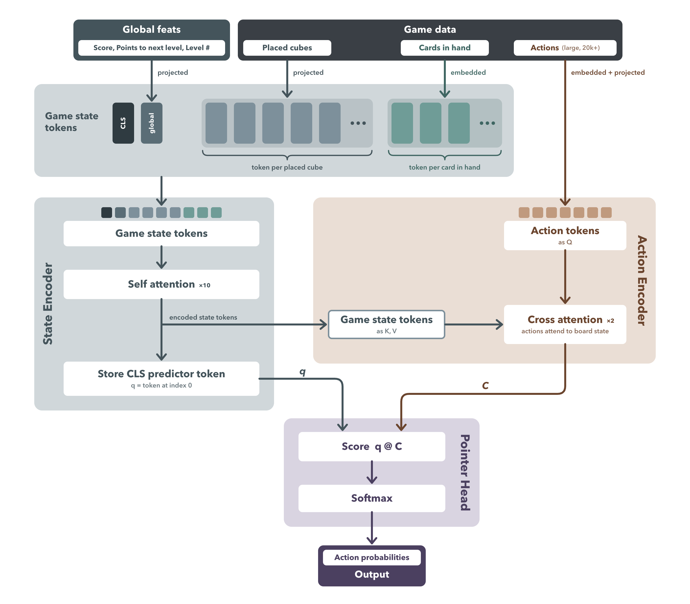

# ABOUT
Floating Frontiers RL bot is trained to play [Floating Frontiers](https://store.steampowered.com/app/4034080/Floating_Frontiers/), A city building strategy game I developed.
- Trained in a fast C RL enviornment 1:1 replica of the real game logic
- Set point transformer achitecture, generates score all valid actions and picks highest one
- 7M parameter network trained locally on M4 Macbook pro

# The RL enviornment
`/Engine` is a fast replica of floating frontiers logic, written in C. The real game has four maps, but for now the bot only plays the first map, which has simpler rules.

# Set pointer transformer

  

The bot is a set pointer transformer. The game state is represented as three data types:
1) `X_placed`: Cubes on the board are unordered tokens, inputed as `[cube_id, x, y, z, rot]`
2) `X_hand`: Gamepieces in hand are unordered tokens, inputed as `[gamepieceID]`
3) `Y_actions`: The ~20k enumeration of all possible valid actions is `[GamepieceID, x, y, z, rot]` action. The model outputs a choice of one of these actions
4) `global_features`: Global game data `[Score, Points to next level, level #]`

The flow is:
1) Build game state tokens: Build the tokens, cocatenating and projecting/embedding where neccessary, to build the tokens `[CLS | global_features | X_placed | X_hand]`
2) Run sequential transformers (attn -> MLP) on game state tokens
4) Output `H: (n, d)`, and grab the dedicated 0th index CLS token, which the model learn is always used to score the output, `q = H[0]`
5) Generate `C` : Embed actions as tokens (~20k+ tokens)
6) Pass `C` through cross attention transformer. Q's come from actions, K, V comes from game state tokens, so that actions attend to game state tokens. Actions don't attend to each other since there are far too many.
7) Compute `res = softmax(C * q)`. This scores each action against the models predicted action in the CLS token, then softmax to choose the highest match
8) Sample random action from res distribution

Quirks on data format choices:
- Placed cubes can be represented as a cube ID, and position and rotation, where each cube is separate
- Cards in hand must be represented as a unique ID, (~50 unqiue IDs)

## Training
- Train with RL and PPO 
- Value head that predicts action scores

## Possible future work
- Give model the raw score number associated with each input
- Brute force tree search approach: 20k action possibilities per move, but actions later in the tree are heavily repeated and so can
be cached.
- Give the priviledged model raw probailities from the game actions, let it do a brute force search better